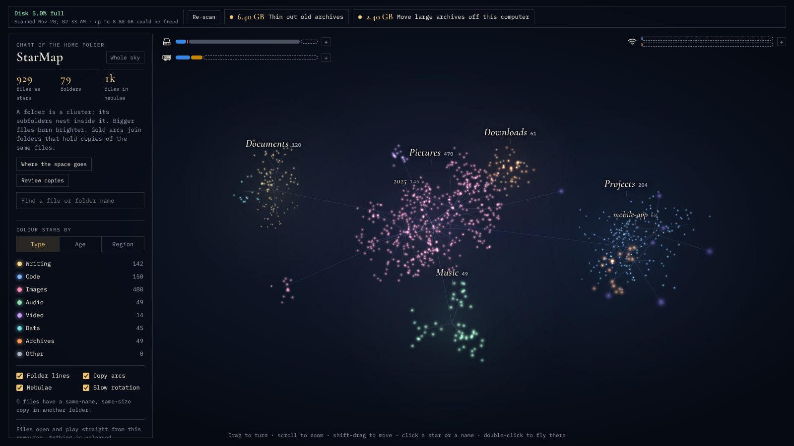
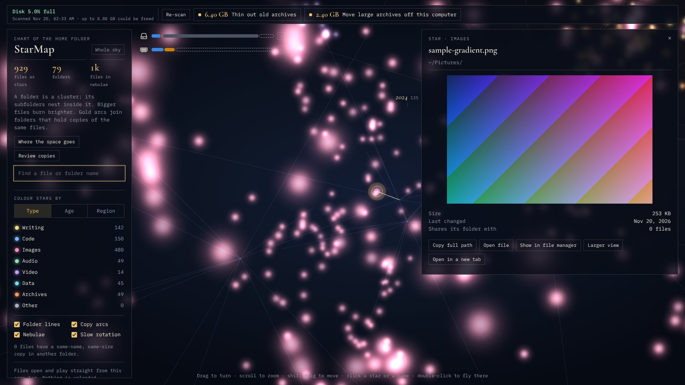

# StarMap File Explorer

See every file on your computer as a star. StarMap draws your home folder as a 3D star map, shows where your disk space has gone, finds duplicate copies, and keeps live disk, memory and network readouts on screen. It runs on macOS, Windows and Linux, needs nothing but Python, and nothing ever leaves your computer.



## What it does

- **A map of your files.** Each file is a star, sized by how big it is and coloured by type (writing, code, images, audio, video, data, archives). Each folder is a cluster with its subfolders nested inside. App bundles and dependency folders such as `node_modules` are drawn as violet nebulae so they don't drown out your own files.
- **Where the space goes.** A breakdown of the biggest items, the biggest folders, the system folder (Library on a Mac, AppData on Windows) and the main folders outside your home folder, plus how much space is in use that the scan couldn't locate.
- **Recommendations.** A bar across the top lists what could free the most space on this computer, each marked "Safe to clear", "Check first" or "Look here first", with steps and the commands to run. StarMap shows commands; it never runs them for you.
- **Duplicate copies.** Gold arcs join folders that hold copies of the same files. The copy review lets you tick the spare copies and move them to the Trash or Recycle Bin, after StarMap checks byte for byte that an identical copy is being kept.
- **Previews.** Click a star to play audio and video, view images and PDFs, read text, code and Word documents, open the file in its app, or show it in Finder or File Explorer.
- **Live readouts.** Disk, memory (with the apps using the most) and network speed, updated every few seconds. Each collapses to a single bar with its minimise button.



## Get started

You need **Python 3.9 or newer**. There is nothing else to install.

1. Download StarMap: on this page click **Code**, then **Download ZIP**, and unzip it. Or clone it:
   `git clone https://github.com/Pr3ndy-ctrl/StarMap-File-Explorer.git`
2. Start it:

| System | How to start | First time only |
|---|---|---|
| **macOS** | Double-click `StarMap.command`. | macOS may say it can't check the file. Right-click `StarMap.command`, choose **Open**, then **Open** again. When macOS asks whether Terminal may access Documents, Desktop or Downloads, choose **Allow** so those folders are included. If Python is missing, run `xcode-select --install` or install it from [python.org](https://www.python.org/downloads/). |
| **Windows** | Double-click `StarMap.bat`. | If Windows SmartScreen appears, choose **More info**, then **Run anyway**. If Python is missing, install it from [python.org](https://www.python.org/downloads/) and tick **Add python.exe to PATH**. |
| **Linux** | Run `./StarMap.sh` in a terminal. | Install `python3` with your package manager if it isn't there. |

You can also run it directly from any terminal with `python3 starmap.py` (on Windows, `py starmap.py`).

StarMap opens the map in your browser. The first scan reads your whole home folder and can take a few minutes on a full drive; a progress bar shows how far it has got. Leave the small window StarMap started in open while you use the map, and close it (or press Ctrl+C) to stop StarMap.

## Using the map

- **Drag** to turn the map, **scroll** to zoom, **shift-drag** to move it. **Click** a star or a folder name for its details; **double-click** to fly to it. **Whole sky** brings you back.
- **Find a file or folder name** lights up every match.
- **Colour stars by** switches between file type, age and region (top-level folder).
- **Where the space goes**, **Review copies** and the **recommendation bar** open their reports in the right-hand panel.
- **Re-scan** reads the computer again after you've cleaned up, with a progress bar.

## Privacy and safety

- StarMap reads file **names, sizes and dates**. To spot duplicates it also reads a small sample from the start and end of files that share a name and size. Files stored only in iCloud, OneDrive or similar are never downloaded to be read.
- Nothing is uploaded. The map is served from `127.0.0.1`, which is this computer only, and all its parts (3D library, fonts, document viewer) ship with StarMap, so the page makes no requests to the internet.
- Every start creates a new random key, so other websites and other people on your network can't use StarMap. See [SECURITY.md](SECURITY.md).
- StarMap changes files in exactly two cases, both only when you press the button: **Open file** asks your system to open a document (it refuses programs and scripts), and **Move ticked copies to the Trash** moves duplicate copies to the Trash or Recycle Bin, never deleting outright, and only after a byte-for-byte check against a copy you keep.
- It saves its last scan in one file, so the map opens instantly next time:
  - macOS: `~/Library/Application Support/StarMap/scan.json`
  - Windows: `%LOCALAPPDATA%\StarMap\scan.json`
  - Linux: `~/.local/share/starmap/scan.json`

  Delete that folder to remove everything StarMap has stored.

## Options

```
python3 starmap.py [--port PORT] [--no-browser] [--version]
```

| Option or variable | Effect |
|---|---|
| `--port 8123` | Use that port on 127.0.0.1. By default StarMap uses 47615, or the next free one. |
| `--no-browser` | Don't open the browser; open the printed address yourself. |
| `STARMAP_HOME=/some/folder` | Map a different folder instead of your home folder. |
| `STARMAP_DATA=/some/folder` | Keep the saved scan somewhere else. |
| `STARMAP_OUTSIDE=` | Skip measuring folders outside the home folder (faster). |

If the [`psutil`](https://pypi.org/project/psutil/) package is installed (`pip install psutil`), StarMap uses it for more detailed memory and network figures. Without it, StarMap reads them with the tools built into each system.

## Try it without your own files

`tools/demo_home.py` builds a made-up home folder full of sample files (they take about 25 MB on disk even though the map shows them at realistic sizes):

```
python3 tools/demo_home.py /tmp/demo-home
STARMAP_HOME=/tmp/demo-home STARMAP_OUTSIDE= python3 starmap.py
```

The screenshots on this page were made that way.

## Good to know

- Home folders with more than 250,000 files are mapped in full up to that point; further folders are drawn as nebulae so the map stays quick.
- Some places can't be measured without administrator rights, such as other people's accounts and parts of the system. StarMap reports what it couldn't reach instead of guessing, and the "Look here first" recommendation explains where the rest of the space usually is on each system.
- On Windows without `psutil`, memory is shown as used and free (no breakdown of cached memory).
- StarMap works best in a current Chrome, Edge, Firefox or Safari. Playing a video depends on the formats your browser supports.

## Development

```
python3 -m unittest discover -s tests -v
```

The tests build a small sample home folder, scan it, start the server and exercise every request the page makes, including the refusals. They run on macOS, Windows and Linux with Python 3.9 and 3.13 on every push, followed by `tests/check_launch.py`, which starts StarMap the way a person would and checks it answers (see `.github/workflows/tests.yml`).

| Path | What it is |
|---|---|
| `starmap.py` | The whole app: scanner, live readouts and the local web server. Standard library only. |
| `web/index.html` | The map page. |
| `web/vendor/`, `web/fonts/` | three.js, Mammoth and two fonts, bundled so StarMap works offline. See [THIRD_PARTY_NOTICES.md](THIRD_PARTY_NOTICES.md). |
| `StarMap.command`, `StarMap.bat`, `StarMap.sh` | Double-click starters for macOS, Windows and Linux. |
| `tools/demo_home.py` | Builds a sample home folder. |
| `tests/` | The test suite. |

## Licence

MIT, see [LICENSE](LICENSE). Bundled third-party files keep their own licences, listed in [THIRD_PARTY_NOTICES.md](THIRD_PARTY_NOTICES.md).
