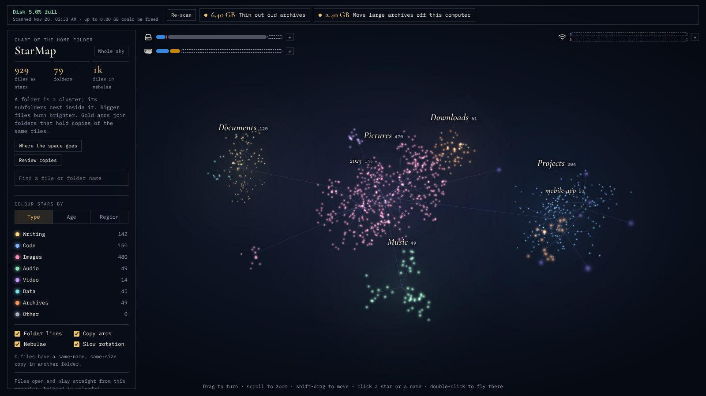

# StarMap File Explorer

StarMap draws every file in your home folder as a star in a 3D map, shows where your disk space has gone, helps you clear out duplicate copies, and keeps live disk, memory and network readouts on screen. It runs on macOS, Windows and Linux, needs only Python, and nothing ever leaves your computer.

## Start here

- **[Getting started](Getting-Started)**: download StarMap, start it on your system and run the first scan.
- **[Using the map](Using-the-Map)**: moving around, colours, search and the side panels.

## Guides

- [Where the space goes](Where-the-Space-Goes): reading the disk-space report.
- [Recommendations](Recommendations): what each suggestion means and how safe it is.
- [Cleaning up duplicates](Cleaning-Up-Duplicates): reviewing copies and moving spares to the Trash.
- [Previews and opening files](Previews-and-Opening-Files): what can be played or shown inside StarMap.
- [Live readouts](Live-Readouts): the disk, memory and network figures.

## Reference

- [Privacy and security](Privacy-and-Security)
- [Options and settings](Options-and-Settings)
- [Troubleshooting](Troubleshooting)
- [FAQ](FAQ)
- [Development](Development)

The latest version is always on the [main page of the repository](https://github.com/Pr3ndy-ctrl/StarMap-File-Explorer).
